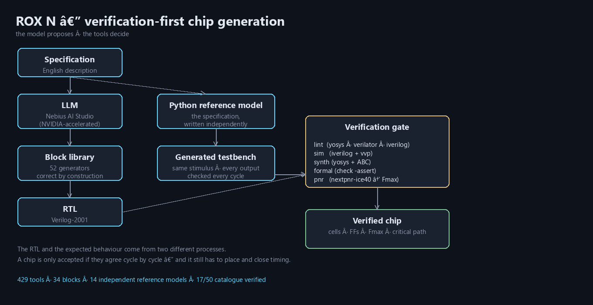
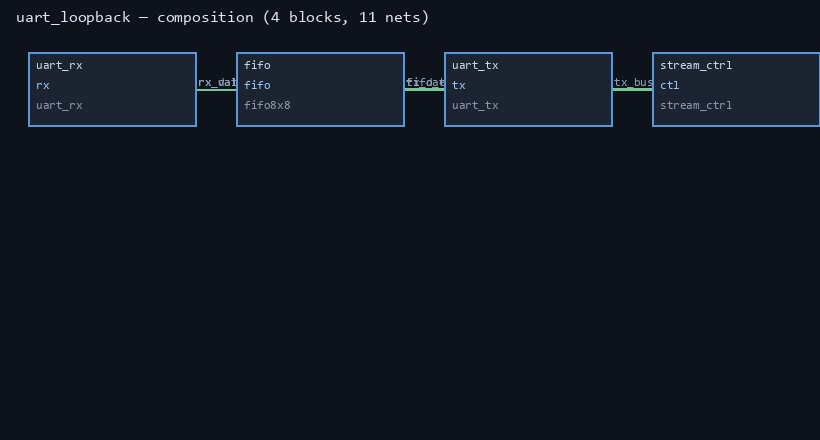

# ROX N — the AI that proves the chip works

**Nebius × NVIDIA hackathon submission.**

**Live project page: https://kyo803.github.io/rox-n/**

Describe a chip in English. ROX N writes the RTL, writes an **independent
reference model of the specification**, generates the testbench from that
model, and drives a real toolchain — lint, simulation, synthesis with ABC,
formal checks, and FPGA place-and-route with timing.

It does not tell you the chip works. **It proves it, or it fails the gate and
tells you why.**



---

## The problem

Every "AI writes Verilog" demo has the same hole: the model writes the design
*and* the test, so the test agrees with the bug. It looks correct and isn't.

ROX N removes the model from the trust path.

## How it actually works

1. **Spec → design.** An LLM (Nebius Token Factory, NVIDIA-accelerated,
   default `nvidia/nemotron-3-super-120b-a12b`) proposes a design:
   either a **graph of known-good blocks** or an RTL draft.
2. **Spec → reference model.** A *Python model of the specification* is
   written independently. It never sees the RTL.
3. **Reference model → testbench.** `refsim` runs that model over a stimulus
   schedule and **generates the testbench**: same inputs, every output
   compared, every cycle.
4. **The gate.** `lint → sim → synth (ABC) → formal → place & route`.
   A chip is accepted only if all five pass.

Because the RTL and the expected behaviour come from two different processes,
a pass means *the design matches the specification* — not that it matches
itself. And the testbench is generated, so nobody can edit it into agreement
with a broken design.

## What is real today

| | |
|---|---|
| deterministic block library | **70 generators**, 39 with independent reference models |
| gate | lint · simulation (iverilog) · synth (yosys + ABC) · formal · **place & route (nextpnr-ice40)** |
| real timing | `stepper` 646 MHz · `segmux` 655 MHz · `reset_sync` 627 MHz · `cdc_sync` 627 MHz |
| multi-block chip | `uart_loopback` — 613 cells / 159 FF, **135.9 MHz**, byte in → byte out |
| catalogue | **44 / 50** designs built, each through the full gate |
| chip visibility | **2D floorplan from real nextpnr placement** (one region per module core) · VCD waveforms rendered to PNG and opened in **GTKWave** |
| security | authorisation-first method KB (235 entries) · SAST incl. C/C++ memory bugs · secret scan · **PE/ELF triage without executing the sample** |
| agent surface | **434 tools**, 22/22 live self-checks (incl. browser control, web search) |
| interface | OpenCode-style terminal UI with live thinking and tool trace |



*The UART loopback chip as ROX N sees it: four blocks, eleven nets, every
connection width-checked before a line of Verilog is emitted.*

## Quickstart

```powershell
# 1. hosted inference (optional — falls back to local Ollama)
$env:NEBIUS_API_KEY = "..."        # Nebius Token Factory
$env:ROX_NEBIUS_MODEL = "nvidia/nemotron-3-super-120b-a12b"

# 2. build and verify a chip
cd ROX-N\lm_track\rox_chat
py -3.15 -c "import chipflow; r = chipflow.build('demo', spec='an 8-bit counter'); print(chipflow.summary_text(r))"

# 3. the terminal UI
rox_tui\rox-tui.exe
```

The toolchain runs inside WSL; ROX N detects it automatically and, if it is
missing, installs `iverilog verilator yosys gtkwave nextpnr-ice40` for you.

## Results, including the failures

[`submission/RESULTS.md`](submission/RESULTS.md) lists all 50 catalogue
designs: what each one is, what it is used for, and either its area/timing or
the exact reason it was rejected.

The failure taxonomy is the point, not an embarrassment:

| failure | count | meaning |
|---|---|---|
| testbench/elaboration | 5 | the model wrote a testbench that did not compile |
| formal equivalence | 1 | the design failed `check -assert` against its own netlist |

Every one of these 6 is a **model-generated** design. The 44 that pass include
8 that were originally model failures, then rebuilt as deterministic generator
blocks with independent reference models — `booth` (which exposed a real
signed-accumulator overflow), `quadrature` (a Verilog signedness bug where
`pos + step` with signed `step` and unsigned `pos` zero-extends −1 to +3), and
`crc8`, `cdc_sync`, `manchester_enc`, `reset_sync`, `uart_parity`, `bitrev`.

We report **44/50** because the gate refused the rest.

[`submission/BENCHMARK.md`](submission/BENCHMARK.md) measures the hosted model
directly: with the model writing both RTL and testbench it passed 0/6 of the
hardest designs (four failures were broken testbenches, not broken RTL); with
RTL alone against an independent reference-model testbench it passed 2/10
one-shot and 5/10 with up to two repairs.

## Why Nebius × NVIDIA

- The design model runs on **Nebius Token Factory** (OpenAI-compatible,
  NVIDIA-accelerated, default `nvidia/nemotron-3-super-120b-a12b`). The
  adapter is endpoint-agnostic: point `ROX_NEBIUS_URL` at an **NVIDIA NIM**
  endpoint and the same agent uses it.
- Everything that *decides* runs locally and deterministically. No network
  dependency in the verification path — a demo cannot be derailed by Wi-Fi.
- The architecture is a statement about AI reliability: **the model proposes,
  the tools decide.**
- Nemotron-3 is a reasoning model, so by default we disable its reasoning
  trace (`reasoning_effort: none`) and spend the whole token budget on the
  Verilog. Trust comes from the gate, not from the model's chain of thought —
  and leaving reasoning on caused the model to exhaust its budget before
  emitting any code at all.

## Honest limits

- Place-and-route targets **iCE40 FPGA**, not an ASIC. The timing numbers are
  real; ASIC mapping is future work.
- 44/50, not 50/50.
- The local machine has no NVIDIA GPU; the GPU work happens in Nebius
  inference.

## Repository layout

```
submission/
  README.md           judge-facing writeup
  ARCHITECTURE.md     the verification design in detail
  RESULTS.md          all 50 designs, verified and rejected
  BENCHMARK.md        Nemotron measurements, including the failures
  DEMO.md             3-minute demo script
  assets/             architecture, composition graph, die map, gate schematic, 3D package,
                      plus 3:2 gallery exports in assets/gallery/
lm_track/rox_chat/
  chipflow/           the engine: blocks, reference models, gate, P&R, composition
  rox_tui/            the terminal UI (Go)
  nemotron_bench.py   hosted-model benchmark (the form's numbers)
  tools_selftest.py   429-tool self-test
desktop/
  ui/index.html       native desktop client (Rust/Tauri shell + Go launcher)
docs/
  NEUROMORPHIC.md     the earlier neuromorphic architecture track
```

---

## Authorship

Copyright © 2026 **Zaim Khan (ROX N)**. Licensed Apache-2.0.

See [NOTICE.md](NOTICE.md) for provenance (first public commit, repository of
record) and the attribution requirements anyone redistributing this work must
follow.

---

> "Anyone can make a model write Verilog. ROX N makes it prove the chip
> works — or refuses to call it a chip."
